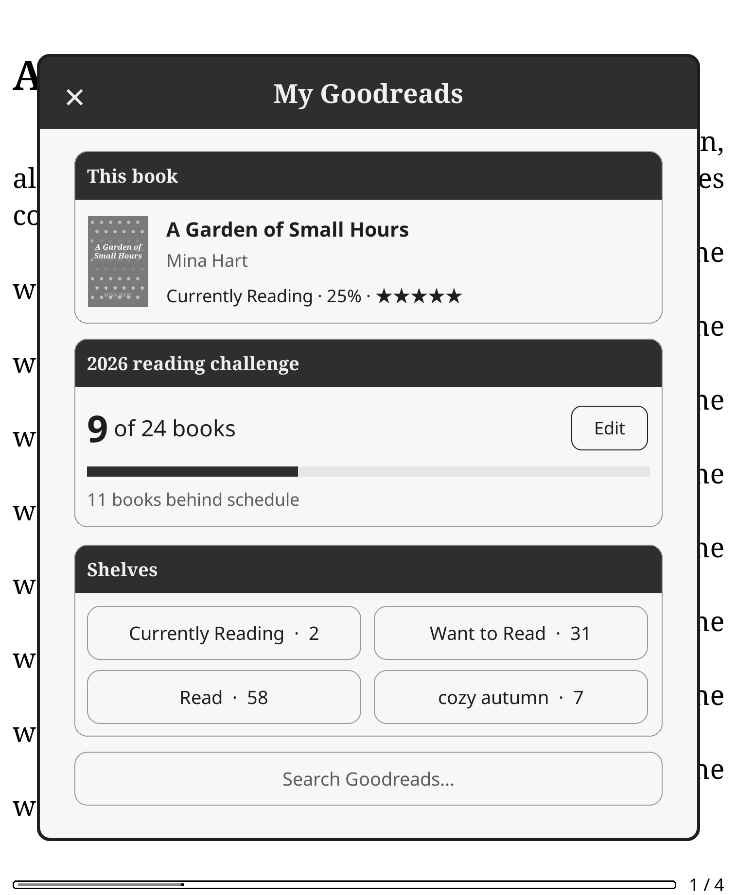
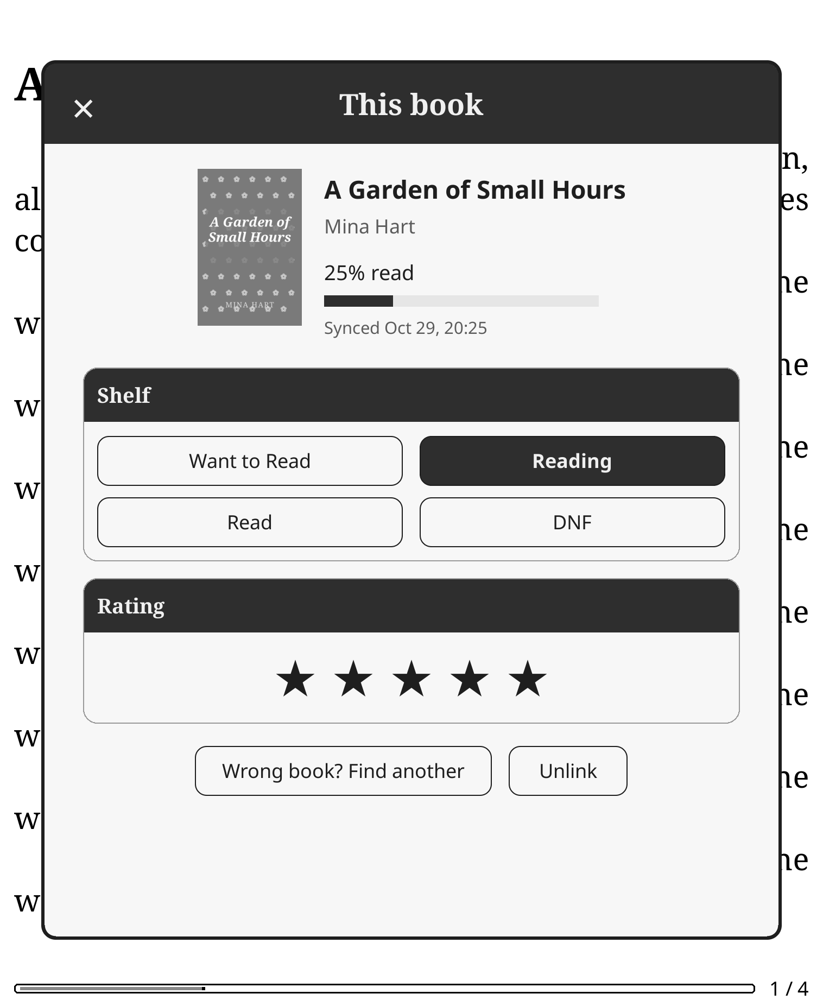
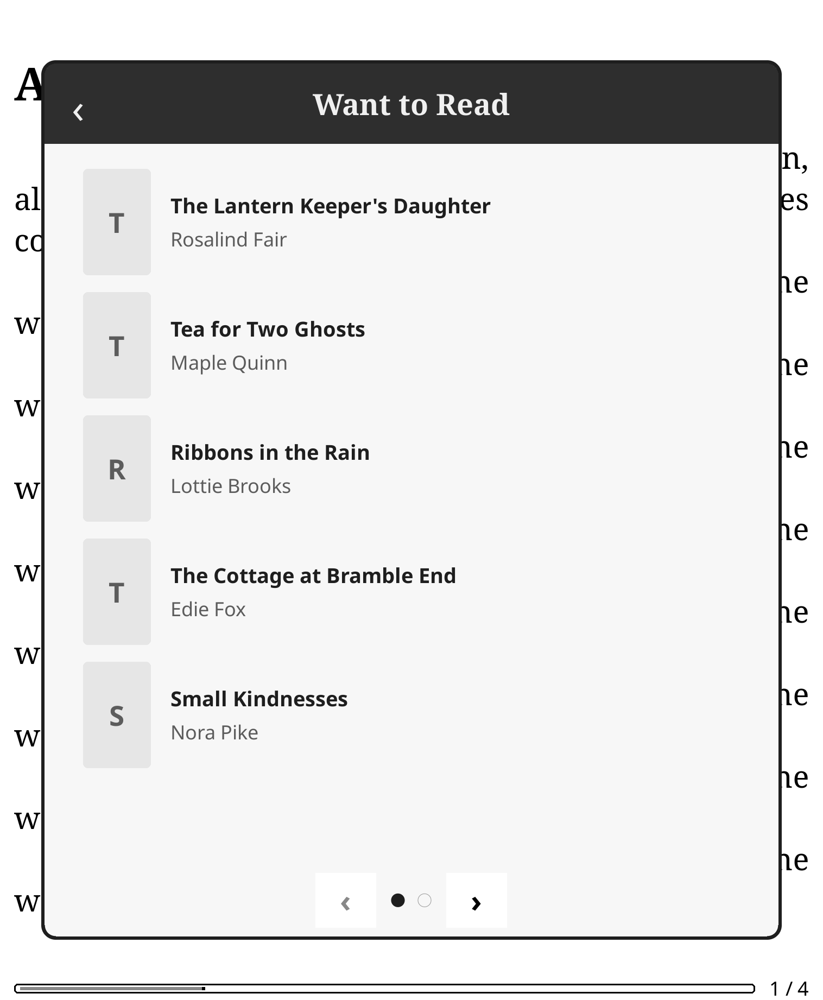
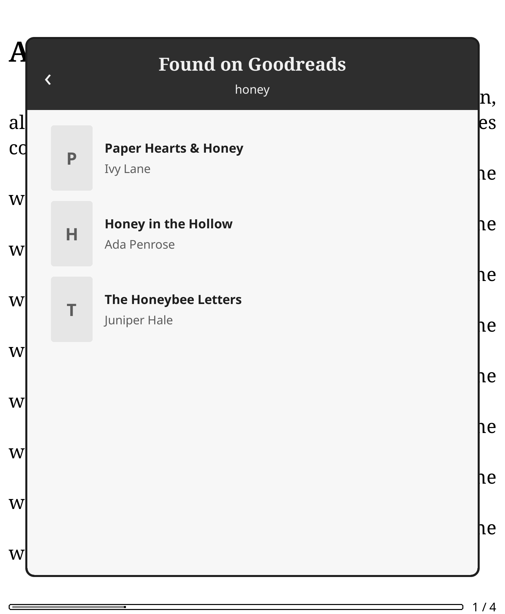
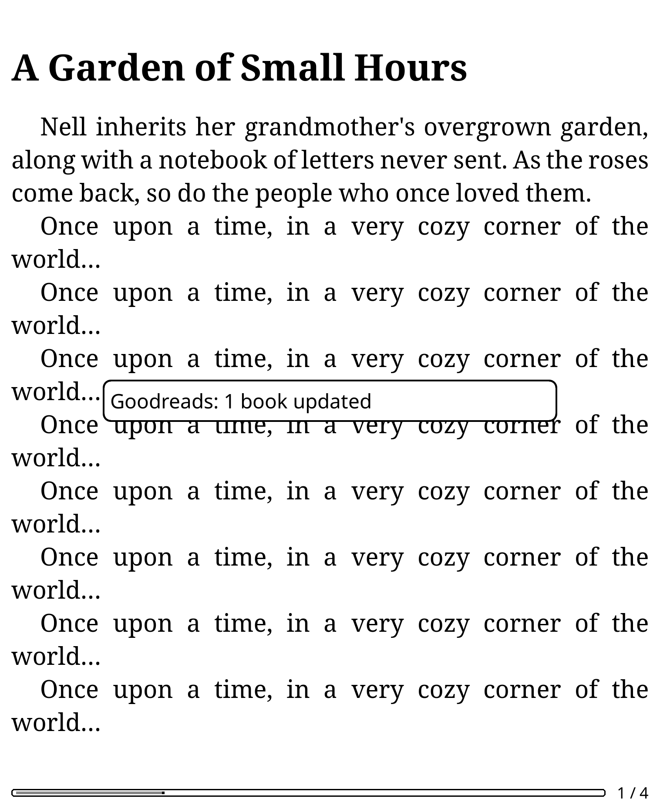

# Goodreads Sync for KOReader

Goodreads Sync keeps KOReader and Goodreads in step:
- reading progress, shelves and ratings
- read dates and rereads
- your KOReader collections
- your yearly reading challenge

Its pages open as windows over your book, styled after the *brew* app: an espresso title bar,
cards with dark section headers, serif titles and warm paper tones, rendered in grayscale for
e-ink. It stays quiet unless something changed.

<p align="center">
  
  
  
</p>
<p align="center">
  
  
</p>

*The screenshots use a made-up library and made-up Goodreads data.*

---

## Contents

1. [Install and updates](#install-and-updates)
2. [Signing in](#signing-in)
3. [What syncs, and when](#what-syncs-and-when)
4. [Read dates and rereads](#read-dates-and-rereads)
5. [Collections and Goodreads shelves](#collections-and-goodreads-shelves)
6. [How books are matched to Goodreads](#how-books-are-matched-to-goodreads)
7. [The pages](#the-pages)
8. [Settings](#settings)
9. [Messages](#messages)
10. [Troubleshooting](#troubleshooting)
11. [What it stores, and privacy](#what-it-stores-and-privacy)
12. [Optional: the Blossom plugin](#optional-the-blossom-plugin)
13. [Uninstall](#uninstall)
14. [For developers](#for-developers)

---

## Install and updates

1. Copy the `goodreadssync.koplugin` folder into KOReader's `plugins` folder:
   - Kindle: `koreader/plugins/`
   - Kobo: `.adds/koreader/plugins/`
2. Restart KOReader.
3. Open **Tools → Goodreads Sync**.

Goodreads Sync works on its own. Nothing else needs to be installed.

### Updates

- **Check for updates (vX)** in the menu looks for a newer release on GitHub. If there is one,
  it asks *"Update now?"*, then downloads, verifies and installs it, and offers to restart
  KOReader.
- **Check for updates automatically** (on by default) checks once a day when Wi-Fi connects.
  It only asks; it never installs by itself.
- **Safety:**
  - every download is checked against its published SHA-256 checksum
  - the new version is unpacked and checked before anything is replaced
  - the previous version is kept until the next start, and put back if the swap fails
  - GitHub never sees your Goodreads sign-in

### Coming from Blossom Reads or Goodreads KO Sync?

- **Blossom Reads** is this plugin's previous name (up to v1.1).
  - On first start, Goodreads Sync carries over its sign-in, linked books, sent read dates and
    settings, so there's nothing to redo.
  - Then delete `koreader/plugins/blossomreads.koplugin`. Goodreads Sync reminds you while it's
    still there, since both would sync the same books.
  - Blossom Reads v1.1's own updater can't make this switch, so install 2.0 by copying the
    folder.
- **Goodreads KO Sync** (`goodreadskosync.koplugin`): turn it off, or both will sync the same
  books.

## Signing in

**Tools → Goodreads Sync → Sign in to Goodreads**: enter the email and password of your Goodreads
(Amazon) account.

Amazon sometimes asks for more:
- **A verification code** (by email or text): you're asked for it.
- **A picture puzzle** ("type the characters you see"): the picture is shown. Close it, then type
  the characters.
- **A check that only works in a browser:** you'll see *"Goodreads asked for a check that can't
  be done here"*. Wait a while, or try from another network.

Once signed in, the menu shows **Signed in as** with your Goodreads user number. With **Remember
password** on (the default), the password is saved, encrypted, so you don't have to type it
again if Goodreads signs you out later.

## What syncs, and when

| When | What happens |
|------|--------------|
| **Wi-Fi connects** | Books whose progress changed since the last sync, your collections and the yearly goal |
| **Waking up** (only if Wi-Fi is already on) | The same; it never turns Wi-Fi on by itself |
| **Closing a book** (only if Wi-Fi is on) | That book, straight away |
| **Sync now** (menu or gesture) | Everything; Wi-Fi is turned on if needed |

- **Pacing:** automatic syncs (Wi-Fi, wake) run at most every 5 minutes, and never two at once.
- **Quiet:** an automatic sync shows a short note only when something changed, such as
  *"Goodreads: 2 books updated"*. Problems during automatic syncs are only written to the log.
- **Hiccups are retried:** each request is tried up to 3 times when Goodreads is over capacity,
  rate-limiting or drops the connection. A book that still fails is tried again at the next sync.

### What gets sent for each book

| In KOReader | On Goodreads |
|---|---|
| You start a book (progress above 0%) | Moved to **Currently Reading** |
| You read further | **Progress** updated (whole percent). It only goes *up*: re-reading never moves Goodreads backwards |
| You mark it finished (book status "Finished") | Moved to **Read**, with that day as its **date read** |
| You reach 99% and **Mark Read at 99%** is on | Moved to **Read** |
| You mark it "On hold" | Nothing changes. Choose *DNF* on the This book page if you want |
| You pick a shelf on the This book page | That shelf is kept. Automatic *Currently Reading* won't override it, but finishing the book still marks it Read |
| You tap stars on the This book page | The star rating on Goodreads |

## Read dates and rereads

Goodreads counts a book toward a year's reading challenge by its **date read**.

- **Date finished:** the day KOReader marked the book *Finished*.
- **Date started:** the first page you read, from KOReader's reading statistics (when known).
- **Older books:** books you finished before installing get their own dates too, so they count in
  the year you actually read them.
- **Existing dates win:** if Goodreads already has a date for the book (in any edition), it's left
  alone.

**Rereads.** Read a finished book again from (near) the beginning, then mark it *Finished* again
on a later day. Goodreads gets a **new read date**, which counts toward that year's challenge.
- A book marked finished without being read through (say, at 13%) isn't treated as a reread.
- Changing a status back and forth on the same day doesn't create one.

**How it works.** Shelving a book as Read creates a reading session with no dates. Goodreads Sync
saves the dates through the book's Goodreads review page, the same way the website does.

**Safety:**
- it only writes to editions **without a written review**, so a review can never be changed
- your private notes are sent back exactly as they were
- nothing is posted to your update feed or blog
- each save is checked by reloading the page

You can turn this off with **Send read dates and rereads**.

## Collections and Goodreads shelves

KOReader **collections** (long-press a book → *Add to collection*) are mirrored onto Goodreads
shelves:

| Collection name | Goodreads shelf |
|---|---|
| To Be Read, TBR, Want to Read, To Read | **Want to Read** |
| Currently Reading, Reading | **Currently Reading** |
| Read, Finished, Done | **Read** |
| DNF, Did Not Finish | **Did Not Finish** |
| favorites (KOReader's built-in collection) | a **favorites** shelf |
| anything else, e.g. "Autumn 2026" | a shelf with the same name: **autumn-2026** |

**Your reading status always wins.** Goodreads keeps one status shelf per book.
- A book in *To Be Read* that you haven't started goes to **Want to Read**.
- Once you start it, it's **Currently Reading**; when you finish, it's **Read**.
- A book in two status collections gets the stronger one: Read > Currently Reading > DNF > Want to
  Read.

**Other shelves are kept matched.** Shelves like *favorites* are added alongside the status, and
removed again when the book leaves the collection. Only shelves Goodreads Sync added are ever
removed, and never status shelves.

Change any collection's shelf in **Collections → shelves**: Automatic, a status shelf, another
shelf name, or *Don't sync*.

## How books are matched to Goodreads

A book on your e-reader has to be **linked** to its Goodreads book before it can sync. Goodreads
Sync does this by itself.

- **When:** a few books per sync.
  - Books marked *Finished* anywhere in your library come first. Sync now looks for those every
    time; automatic syncs once a day.
  - Then collections and reading history.
  - Sync now links up to 25 books, automatic syncs up to 8.
  - A book is also linked when you open it while Wi-Fi is on.
  - Only real books are linked (not KOReader's help pages, for example).
- **How:**
  1. The book's **ISBN or ASIN**, if it has one.
  2. Otherwise its **title**, then title and author. The details come from the book, the Cover
     Browser cache, or the file name. Names like `(2) Title - Author.epub` and
     `6 - Title.epub` work.
  3. **It only links when it's sure:**
     - With an author, the match has to be exact and clearly the best.
     - Without one, Goodreads' top result has to be the only book with that exact title.
     - If several books share the title, the one whose series matches the book's folder wins
       (e.g. `Books/Glass Crown/Queen of Lanterns.epub`).
- **Your edition:** if you already have the book on a Goodreads shelf in another edition, that
  edition is linked.
- **No clear match?** The book waits a week before it's searched again. Link it yourself with
  **This book → Find on Goodreads**.
- **Wrong match?** **This book → Wrong book? Find another**, or **Unlink**.

## The pages

All pages open as a window over your book or bookshelf. Close one by tapping outside it, swiping
down, or tapping **×**. In lists, swipe or use the page keys to turn pages.

- **My Goodreads** (**Open Goodreads Sync**):
  - **This book:** cover, title, author, shelf, progress and stars. Tap it for the This book page.
  - **Reading challenge:** books read of your goal, a progress bar, and whether you're ahead of or
    behind schedule. **Edit** changes the goal.
  - **Shelves:** your shelves with counts. Tap one to browse it.
  - **Search Goodreads…:** by title, author or ISBN.
- **This book:**
  - the Goodreads match, with your progress
  - **Shelf** (Want to Read · Reading · Read · DNF)
  - **Rating** (tap a star)
  - **Wrong book? Find another** and **Unlink**
- **Shelf / search results:** books with covers, page by page. Tap a book to put it on one of
  your shelves.

## Settings

**Tools → Goodreads Sync**:

| Item | What it does | Default |
|---|---|---|
| **Sync now** | Sync everything now (turns Wi-Fi on if needed) | — |
| **Last sync: …** | When the last sync ran and what it did; tap to see why it failed | — |
| **Open Goodreads Sync** | The My Goodreads page | — |
| **This book** | The This book page (while reading) | — |
| **Sync when Wi-Fi connects** | Automatic sync when Wi-Fi comes on | On |
| **Sync on wake** | Automatic sync on wake, if already online | On |
| **Sync when closing a book** | Send that book when you close it, if online | On |
| **Link books automatically** | Link books by ISBN / title and author | On |
| **Sync collections to shelves** | Mirror KOReader collections onto Goodreads shelves | On |
| **Collections → shelves** | Per collection: Automatic, a status shelf, another shelf, or Don't sync | Automatic |
| **Mark Read at 99%** | Treat 99% as finished | Off |
| **Send read dates and rereads** | Date read from KOReader's finish date; rereads as new read dates | On |
| **Sign in / Signed in as …** | Sign in, or sign out | — |
| **Check for updates (vX)** | Look for a newer version and install it | — |
| **Check for updates automatically** | Once a day on Wi-Fi; asks before installing | On |
| **Remember password** | Keep the password, encrypted. Turning it off deletes it | On |

**Gestures** (Settings → Taps and gestures → Gesture manager → General):
- *Goodreads Sync: sync now*
- *Goodreads Sync: open*
- *Goodreads Sync: this book* (while reading)

## Messages

| Message | What it means | What to do |
|---|---|---|
| *Goodreads: 2 books updated · 1 linked · 1 read date added* | A sync sent changes | Nothing |
| *Up to date* | Nothing needed sending | Nothing |
| *Couldn't sync — no Wi-Fi* | Goodreads couldn't be reached | Turn Wi-Fi on; it'll catch up |
| *Goodreads is busy right now, please try again later* | Goodreads' firewall asked for a check | Try later; you stay signed in |
| *Goodreads didn't answer properly* | Goodreads failed 3 times in a row on something you tapped | Try again in a minute. Details are in the log |
| *Goodreads asked you to sign in again* | The Goodreads session ended | **Sign in again to Goodreads** in the menu |
| *That email or password didn't work* | The sign-in was refused | Check them; try signing in on goodreads.com |
| *Goodreads showed a page this plugin doesn't recognise yet* | Amazon's sign-in pages changed | Please report it (see below) |
| *Goodreads Sync vX is ready … Update now?* | A newer version was released | Tap **Update**, then **Restart** |
| *The download didn't check out, so nothing was changed* | The update didn't match its checksum | Try again later |
| *The old Blossom Reads plugin is still installed …* | The previous version is still in `plugins/` | Delete `blossomreads.koplugin` |

## Troubleshooting

**My books don't sync.**
1. Check that the menu says *Signed in as …*.
2. Run **Sync now**. The note says how many books were updated and linked.
3. Only linked books sync. Open the book and check **This book**. If it isn't linked, tap **Find
   on Goodreads**.

**A finished book has no date read on Goodreads.**
1. Check the book is linked and marked *Finished* in KOReader, then run Sync now.
2. If that edition has a **written review** on Goodreads, it's left alone on purpose. Add the date
   on goodreads.com instead.

**A book is on the wrong shelf.** Pick the right one on **This book**. A shelf you pick yourself is
kept.

**Finding out why something failed.**
- Tap **Last sync** in the menu.
- For details, look in `koreader/crash.log` for lines starting with `GoodreadsSync`. Network
  problems look like this:
  ```
  GoodreadsSync http: POST /shelf/add_to_shelf status 503 err server tries 3
  ```
  These lines only contain the page path and status: never cookies, passwords or page contents.

**Reporting a problem:** open an issue with the `GoodreadsSync` lines from `crash.log`, your
KOReader version and your device.

## What it stores, and privacy

| Where | What |
|---|---|
| `settings.reader.lua`, key `goodreadssync` | Your settings, the last sync summary, the cached challenge and shelf list |
| `settings/goodreadssync/session.lua` | The Goodreads sign-in (cookies), **encrypted** |
| `settings/goodreadssync/credentials.lua` | Email and password, **encrypted**, only with *Remember password* |
| `settings/goodreadssync/keyring.lua` | The encryption key |
| `settings/goodreadssync/books.lua` | Which file is which Goodreads book, what was last sent, and which read dates were sent |
| `settings/goodreadssync/covers/` | Up to 60 cached cover pictures |

- **Encryption:** uses AES through the libcrypto that ships with KOReader. It keeps secrets out of
  plain sight in shared settings, but it isn't protection against someone with full access to the
  device (e-readers have no secure keystore).
- **Network:** Goodreads Sync only talks to goodreads.com, Amazon's sign-in pages, and GitHub (for
  updates). There's no telemetry.

## Optional: the Blossom plugin

Goodreads Sync doesn't need [Blossom](../README.md), the reading-diary plugin in this repository.
If Blossom happens to be installed, two optional extras appear:

- **Share my yearly goal with Blossom** (in the menu, on by default) keeps Blossom's yearly goal
  and your Goodreads challenge goal equal.
  - A change on either side carries across.
  - If both changed, Goodreads wins.
  - Blossom's goals stop at 365; a bigger Goodreads goal shows as 365 in Blossom and is never sent
    back.
- **The challenge card** also shows *"Blossom: N finished this year"*: Blossom's own count from
  KOReader's statistics. The counts aren't merged.

The only thing of Blossom's that Goodreads Sync ever changes is the `yearly_goal` in Blossom's own
settings, and only with that option on.

## Uninstall

Delete `koreader/plugins/goodreadssync.koplugin`. To remove its data too, also delete
`koreader/settings/goodreadssync/` and the `goodreadssync` entry in `settings.reader.lua`.
Nothing changes on Goodreads.

## For developers

```bash
for t in core plan engine load; do luajit tests/test_goodreadssync_$t.lua; done
```

- The tests run with plain LuaJIT and stand-ins for KOReader's modules.
  - The plugin is loaded the way KOReader loads it, with `_meta.lua` fields copied onto it.
  - Network calls go through an injectable transport, so tests never touch Goodreads.
- `tools/screenshots_goodreadssync.sh` runs the KOReader macOS build with a made-up library and
  canned Goodreads answers, and saves `docs/screenshots/gs*.png`.
- **Releasing:**
  1. Bump `version` in `_meta.lua` and commit.
  2. Run `tools/release_goodreadssync.sh "What's new"`. It zips the committed plugin, adds its
     SHA-256, and publishes the GitHub release `goodreadssync-vX.Y.Z` that the in-app updater
     installs.

| Module | Role |
|---|---|
| `main.lua` | Settings, sync triggers (Wi-Fi / wake / close), linking, menu, sign-in dialogs, migration |
| `goodreadssync_plan.lua` | **Pure** decisions: what each book needs, collection shelves, the optional goal merge |
| `goodreadssync_engine.lua` | Runs the plan through an injected API, and builds the summary |
| `goodreadssync_http.lua` | Cookie jar, redirects, retries, error classification, failure log |
| `goodreadssync_login.lua` | Amazon sign-in (two-page flow, code, picture puzzle), session and saved password |
| `goodreadssync_api.lua` | The Goodreads calls: search, shelves, progress, rating, challenge, goal |
| `goodreadssync_review.lua` | Read dates and rereads through the review page (parse, find the save action, save, verify) |
| `goodreadssync_update.lua` | Updates from GitHub releases: check, download, verify, unpack, swap with a backup |
| `goodreadssync_identify.lua` | ISBN / ASIN / file-name parsing and title-and-author scoring |
| `goodreadssync_store.lua` / `_secret.lua` / `_covers.lua` | Files, encryption, cover cache |
| `goodreadssync_view.lua` / `_book.lua` / `_list.lua` / `_theme.lua` | The pages and the minimal theme |

**How it's designed:**
- Decisions are pure and I/O is injected; the planner and engine are tested without a device.
- Network work runs in KOReader's own process, with short timeouts. That keeps multi-step sign-ins
  intact.
- There are no background timers and no queue: a book whose last send failed is simply planned
  again.
